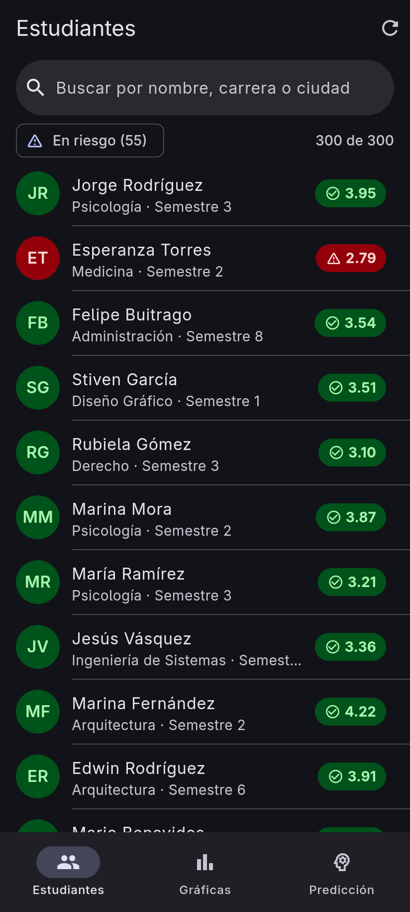
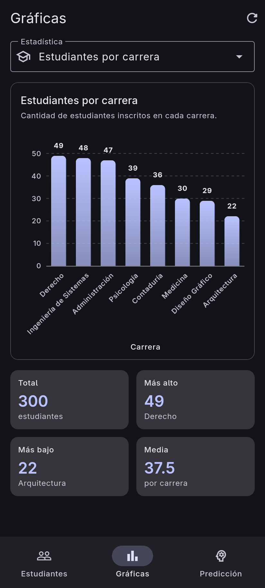
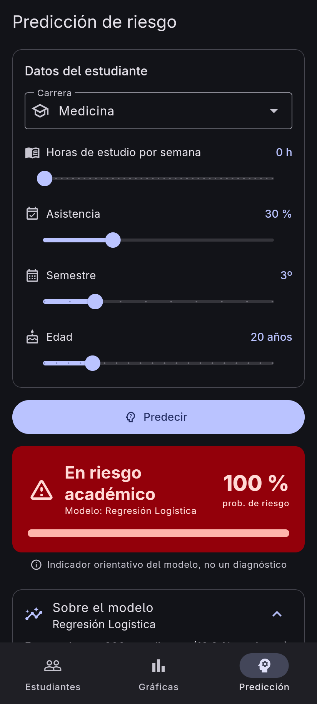
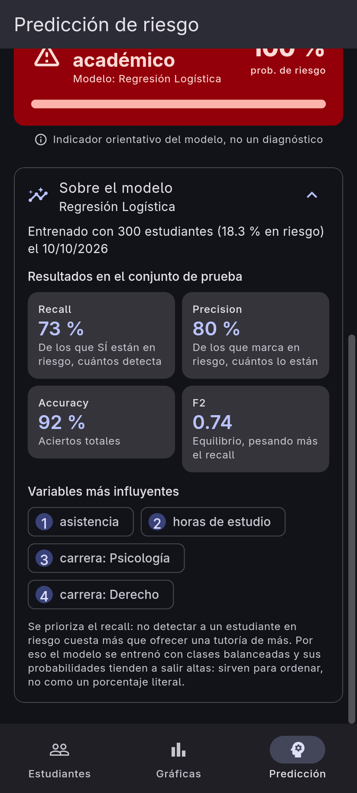
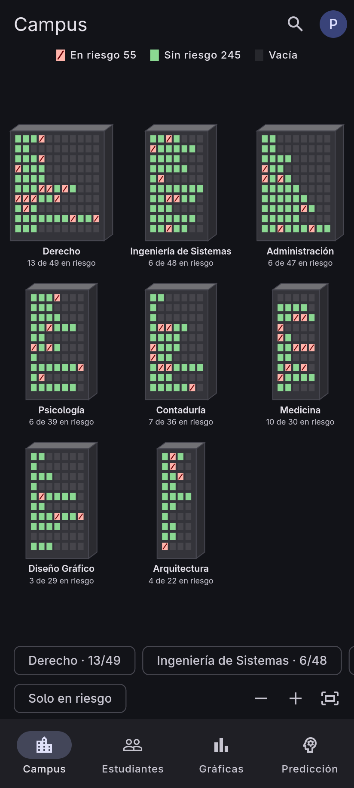
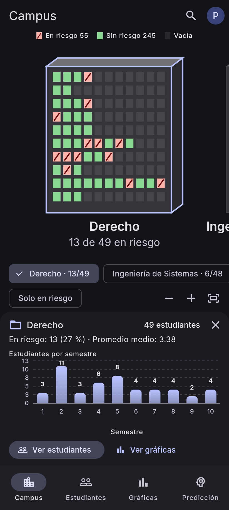
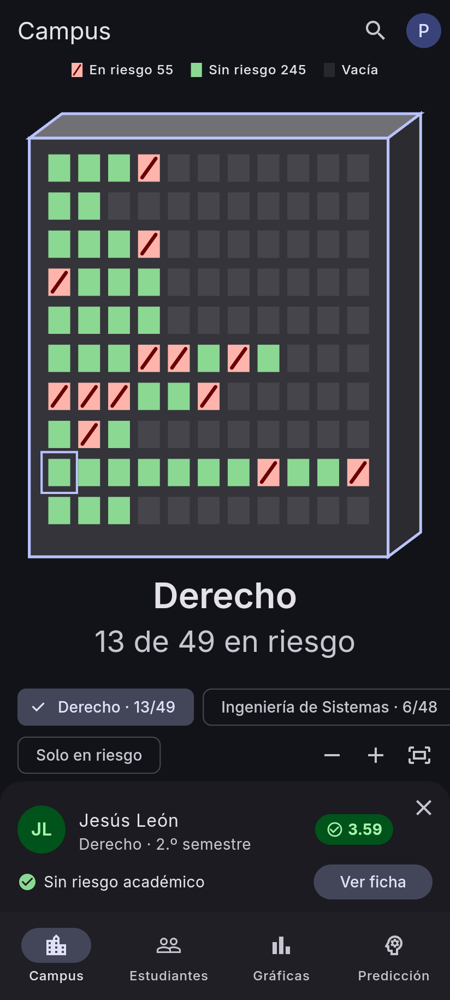
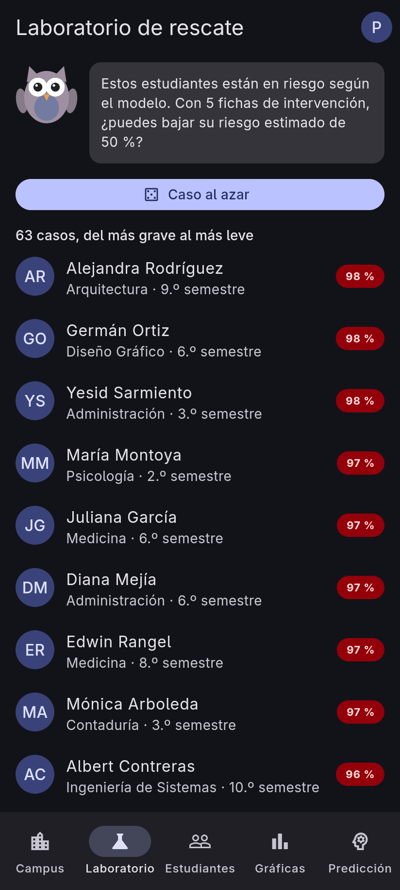
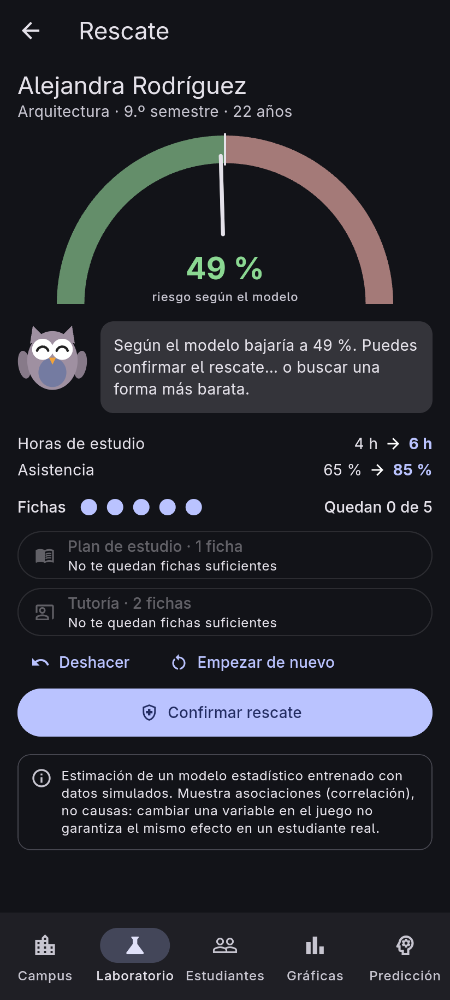
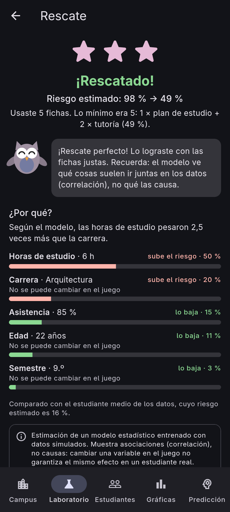

# Estudiantes

App Flutter (Material 3) que consume la API FastAPI de `api-tienda` y tiene
cinco pestañas:

| Pestaña | Qué hace | Endpoints |
|---|---|---|
| **Campus** | Mapa 2.5D (Flame): cada edificio es una carrera, cada piso un semestre y cada ventana un estudiante, roja si está en riesgo. Tocar un edificio abre su expediente; tocar una ventana, la ficha del estudiante | `GET /estudiantes/` |
| **Laboratorio** | Juego de rescate: con 5 fichas (plan de estudio, tutoría) hay que bajar de 50 % el riesgo que estima el modelo para un estudiante real. Medidor en vivo, búho guía, estrellas que decide el servidor y el «¿por qué?» con el peso de cada variable | `/laboratorio/*`, `POST /prediccion/riesgo/lote` |
| **Estudiantes** | Listado con buscador, filtro "en riesgo", indicador de color (promedio < 3.0), pull-to-refresh y pantalla de detalle | `GET /estudiantes/` |
| **Gráficas** | Gráfica de barras (fl_chart) de 6 estadísticas, con el valor encima de cada barra y un resumen | `GET /estudiantes/estadisticas/{tipo}` |
| **Predicción** | Formulario (carrera + 4 sliders) que predice el riesgo académico, con el resultado en rojo/verde y las métricas del modelo | `GET /prediccion/metricas`, `POST /prediccion/riesgo` |

<p>
  
  
  
  
</p>

## Pruébala ya (versión en la nube)

| | Enlace |
|---|---|
| **App web** | <https://buelvasmanuel.github.io/app-estudiantes/> |
| **APK Android** | [Estudiantes.apk](https://github.com/buelvasmanuel/app-estudiantes/releases/latest/download/Estudiantes.apk) ([todas las versiones](https://github.com/buelvasmanuel/app-estudiantes/releases)) · Android 7.0+ |
| **API** | <https://api-tienda-wjac.onrender.com/docs> |

Hace falta una cuenta: al abrir la app, **«¿No tienes cuenta? Regístrate»**
(alias y contraseña de al menos 10 caracteres). En el APK la sesión se
recuerda; en la web, al recargar la página hay que volver a entrar (el token
no se guarda en el navegador, ver [Cuentas y sesión](#cuentas-y-sesión)).

La API está en el plan gratuito de Render, que se apaga tras ~15 min sin uso:
la primera carga puede tardar hasta un minuto (la app lo avisa con
*"Despertando el servidor…"*).

### Instalar el APK

1. Abre el enlace del APK **desde el celular** y descarga `Estudiantes.apk`.
2. Ábrelo. Si Android lo pide, permite **"Instalar apps desconocidas"** para el
   navegador (o el gestor de archivos).
3. Si Play Protect avisa de una app no reconocida: **Más detalles → Instalar de
   todas formas**. (Va firmada con la clave de depuración: sirve para instalarla
   a mano, no para publicarla en Google Play.)

Si ya tenías instalada una versión de `flutter run`, se actualiza encima (misma
firma de depuración).

> **Para ejecutar el proyecto completo (API + app) desde cero en Windows o
> Linux:** ver [INSTRUCCIONES_PROFESOR.md](INSTRUCCIONES_PROFESOR.md).

## Requisitos

- Flutter 3.47 o superior (probado con 3.47.2 / Dart 3.13).
- La API `api-tienda` con datos (`python -m scripts.seed_estudiantes`), el
  modelo entrenado (`python -m scripts.entrenar_modelo`) y las cuentas de
  usuario (`/auth`, ver `docs/CONTRATO_AUTH.md` en `api-tienda`).
- Paquetes: [`http`](https://pub.dev/packages/http),
  [`fl_chart`](https://pub.dev/packages/fl_chart),
  [`flutter_riverpod`](https://pub.dev/packages/flutter_riverpod),
  [`go_router`](https://pub.dev/packages/go_router) y
  [`flutter_secure_storage`](https://pub.dev/packages/flutter_secure_storage).
- **Linux**: `libsecret` (guarda la sesión en el llavero del sistema):
  `sudo apt install libsecret-1-dev` (Ubuntu/Debian) o
  `sudo pacman -S libsecret` (Arch).

```bash
flutter pub get
```

## 1. Arrancar la API

En `~/Proyectos/api-tienda`, con el entorno virtual activado:

```bash
uvicorn app.main:app --reload --host 0.0.0.0
```

`--host 0.0.0.0` hace que la API escuche en **todas** las interfaces de red.
Con el valor por defecto (`127.0.0.1`) solo acepta conexiones del propio PC,
y el celular no podría llegar a ella por WiFi.

Comprueba que responde: <http://127.0.0.1:8000/docs>.

## 2. Ejecutar la app

### Linux (escritorio) — lo más rápido para desarrollar

```bash
flutter run -d linux
```

### Windows (escritorio)

Requiere Visual Studio 2022 con "Desarrollo para el escritorio con C++".

```bat
flutter run -d windows
```

### Chrome / Brave (web)

```bash
flutter run -d chrome
```

Funciona porque la API permite CORS desde cualquier origen
(`allow_origins=["*"]`, solo para desarrollo).

### Celular por USB (recomendado para probar en el celular)

Activa la *depuración USB* en el celular (Opciones de desarrollador),
conéctalo y comprueba que aparece en `flutter devices`. Después:

```bash
adb reverse tcp:8000 tcp:8000
flutter run -d <id-del-celular> --dart-define=API_URL=http://127.0.0.1:8000
```

`adb reverse` crea un túnel por el cable: el puerto 8000 **del celular**
lleva al puerto 8000 **del PC**. Así no dependes de la WiFi, de la IP del PC
ni del cortafuegos. Hay que repetirlo cada vez que se desconecta el cable.

### Celular por WiFi (misma red que el PC)

```bash
ip -4 addr            # busca la IP de la WiFi: inet 192.168.x.y/24
flutter run -d <id-del-celular> --dart-define=API_URL=http://192.168.x.y:8000
```

Si no conecta, abre el puerto en el cortafuegos
(`sudo ufw allow 8000/tcp` o `sudo firewall-cmd --add-port=8000/tcp`).

### Emulador de Android

Crea un emulador en Android Studio (*Device Manager*) y:

```bash
flutter emulators --launch <nombre>
flutter run
```

No hace falta `--dart-define`: en Android la app usa por defecto
`http://10.0.2.2:8000`, la dirección especial con la que el emulador llega al
PC anfitrión (dentro del emulador, `127.0.0.1` es el propio emulador).

## Configuración de la URL de la API

La URL se decide en `lib/config.dart`:

| Dónde corre | URL por defecto |
|---|---|
| APK de la Release y web de GitHub Pages | `https://api-tienda-wjac.onrender.com` (compilada con `--dart-define`) |
| Android (emulador) | `http://10.0.2.2:8000` |
| Windows, Linux, Chrome | `http://127.0.0.1:8000` |
| Cualquiera, con `--dart-define=API_URL=...` | la que indiques |

`String.fromEnvironment('API_URL')` se resuelve **al compilar**: si cambias
la URL hay que volver a lanzar `flutter run` (el *hot reload* no basta).

## Android: `INTERNET` y `networkSecurityConfig`

En `android/app/src/main/AndroidManifest.xml`:

```xml
<uses-permission android:name="android.permission.INTERNET"/>
<application android:networkSecurityConfig="@xml/network_security_config" ...>
```

- **`INTERNET`**: sin este permiso Android no deja que la app abra conexiones
  de red. En modo *debug* Flutter lo añade por su cuenta, pero en *release*
  (`flutter build apk`) la app no podría hablar con la API si faltara.
- **`networkSecurityConfig`**: desde Android 9 se bloquea por defecto el
  tráfico HTTP **sin cifrar** (`http://`, sin la *s*). Hay dos versiones del
  archivo y Gradle elige una según el modo de compilación:

  | Archivo | Se usa en | HTTP sin cifrar |
  |---|---|---|
  | `src/main/res/xml/network_security_config.xml` | release y profile (el APK que se publica) | **No**: solo `https://` (la API de Render) |
  | `src/debug/res/xml/network_security_config.xml` | debug (`flutter run`) | Sí: para la API local (emulador, `adb reverse` o WiFi) |

  Así ningún token de sesión viaja sin cifrar en el APK publicado. Por eso un
  APK de release **no** funciona contra `http://192.168.x.y:8000`: para
  probar con la API local usa `flutter run` (debug).

## Estructura

```
lib/
├── main.dart                  # ProviderScope + MaterialApp.router
├── router.dart                # Rutas (go_router) y barra de 4 pestañas
├── providers.dart             # Providers de Riverpod (ApiService, sesión y datos)
├── config.dart                # URL de la API (--dart-define) y timeout
├── laboratorio/               # Pestaña Laboratorio (CONTRATO_LABORATORIO.md)
│   ├── modelo.dart            # Caso, Intervencion, Explicacion, ResultadoRescate
│   ├── rescate.dart           # Reglas en local (fichas, topes, combinaciones)
│   ├── laboratorio_api.dart   # Endpoints; todas las combinaciones en 1 petición
│   ├── apariencia.dart        # Interfaz búho + medidor (hoy Flutter, mañana Rive)
│   ├── textos.dart            # Lo que dice el búho ("según el modelo…")
│   └── explicacion_vista.dart # El "¿por qué?" y el aviso del modelo
├── campus/                    # Pestaña Campus
│   ├── modelo.dart            # Campus y Edificio (pisos = semestres)
│   ├── disposicion.dart       # Geometría, cámara (Vista) y qué hay bajo un toque
│   ├── controlador.dart       # Estado compartido entre la interfaz y Flame
│   └── juego.dart             # Dibujo con Flame (solo dibuja)
├── theme.dart                 # Tema M3 claro/oscuro + colores de riesgo/ok
├── models/
│   ├── json_utils.dart        # Lectura segura de JSON (num, String, bool...)
│   ├── estudiante.dart
│   ├── estadistica.dart       # Estadistica + enum TipoEstadistica (6 tipos)
│   ├── prediccion.dart        # Entrada, resultado y métricas del modelo
│   └── sesion.dart            # Usuario, Rol y Tokens (respuesta de /auth)
├── services/
│   ├── api_service.dart       # Único punto que habla con la API (+ interceptores)
│   ├── sesion.dart            # GestorSesion: login, registro, logout, refresh
│   └── almacen_refresh.dart   # Dónde se guarda el refresh token
├── screens/
│   ├── acceso_screen.dart     # Login, registro y "recuperando sesión"
│   ├── campus_screen.dart     # Leyenda, mapa, lista de edificios y paneles
│   ├── laboratorio_screen.dart # Lista de casos
│   ├── rescate_screen.dart    # Jugar un caso y ver el resultado
│   ├── estudiantes_screen.dart
│   ├── estudiante_detalle_screen.dart
│   ├── graficas_screen.dart
│   └── prediccion_screen.dart
└── widgets/
    ├── estado_vistas.dart     # Cargando / Error con Reintentar / Vacío
    ├── grafica_barras.dart    # BarChart de fl_chart
    ├── menu_cuenta.dart       # Alias + cerrar sesión (barra superior)
    └── promedio_badge.dart    # Pastilla y avatar con el color del riesgo
```

## Publicar una versión nueva

**Web (GitHub Pages):** se publica sola en cada push a `main` con el workflow
`.github/workflows/web.yml`, que compila con la variable del repositorio
`API_URL`:

```bash
gh variable set API_URL --body "https://api-tienda-wjac.onrender.com"   # una sola vez
git push                                                               # compila y publica
```

**APK:** se compila en local con la URL de la API y se sube como Release:

```bash
flutter build apk --release --dart-define=API_URL=https://api-tienda-wjac.onrender.com
cp build/app/outputs/flutter-apk/app-release.apk Estudiantes.apk
gh release create v1.1.0 Estudiantes.apk --title "Estudiantes 1.1.0" --notes "..."
```

(Sube también `version:` en `pubspec.yaml`, p. ej. `1.1.0+2`, para que Android
la reconozca como actualización.)

## Tests

```bash
flutter analyze                 # análisis estático: 0 issues
flutter test                    # tests de modelos y de widgets (API simulada)
```

Los tests de widgets usan `MockClient` (de `package:http/testing.dart`) para
simular la API: no necesitan red ni la API encendida.

Con la API corriendo, la prueba de extremo a extremo abre la app de verdad y
comprueba que las 3 pestañas cargan datos reales (y las 6 gráficas):

```bash
flutter test integration_test/app_real_test.dart -d linux
```

Registro, refresh, logout y login contra la API real (crea la cuenta que se
indique):

```bash
flutter test integration_test/auth_real_test.dart -d linux \
  --dart-define=API_URL=https://api-tienda-wjac.onrender.com \
  --dart-define=ALIAS=Prueba_Frontend_1 --dart-define=PASSWORD='una contraseña larga'
```

El almacén seguro real de la plataforma (en Linux, libsecret) se prueba con:

```bash
flutter test integration_test/almacen_seguro_test.dart -d linux
```

Para regenerar las capturas de `docs/capturas/` (tamaño celular, datos reales):

```bash
flutter test integration_test/capturas_test.dart -d linux \
  --dart-define=CAPTURAS_DIR=$PWD/docs/capturas
```

## Problemas típicos

| Síntoma | Causa y solución |
|---|---|
| "Sin conexión con la API" | La API no está corriendo, o no escucha en `0.0.0.0`, o la URL no es la correcta para ese dispositivo (ver tabla de arriba). |
| Funciona en Linux pero no en el celular | Falta `adb reverse tcp:8000 tcp:8000` (USB) o la IP/cortafuegos (WiFi). |
| "Servicio no disponible (503): Modelo no entrenado" | En la API: `python -m scripts.entrenar_modelo`. |
| Lista vacía | En la API: `python -m scripts.seed_estudiantes`. |
| El celular aparece y desaparece en `flutter devices` | Hay dos `adb` instalados (`/usr/bin/adb` y el del SDK). Deja solo uno. |
| Cambié `API_URL` y no hace nada | Es de compilación: detén la app y vuelve a hacer `flutter run`. |

## Cuentas y sesión

La app pide iniciar sesión (o registrarse con alias y contraseña) antes de
mostrar nada. Implementa el contrato `docs/CONTRATO_AUTH.md` del repo
`api-tienda`:

| | |
|---|---|
| **Access token** | Va en `Authorization: Bearer …`; dura 15 min y se guarda solo en memoria. Si le queda menos de 1 min, se renueva antes de enviar. |
| **Refresh token** | Android, Windows y Linux: en el almacén seguro del sistema (`flutter_secure_storage`), así la sesión sobrevive a cerrar la app. **Web: solo en memoria** (recargar la página = volver a entrar): en el navegador no hay un almacén realmente seguro. |
| **Interceptor** (`GestorSesion`) | Ante un `401` de token caducado renueva y repite la petición **una vez**. Si varias peticiones necesitan renovar a la vez, hay **un solo refresh en curso** y las demás lo esperan: con tokens rotativos, dos renovaciones con el mismo token parecerían un robo y la API cerraría la sesión. |
| **Sin respuesta al renovar** | Se reintenta con el **mismo** refresh: una vez tras un timeout y hasta 2 tras un error de red, nunca pasados 110 s (la API lo acepta repetido durante 120 s). Si se agotan, error de conexión y se conservan los tokens. |
| **Sesión cerrada** | Si la API rechaza el refresh (sesión revocada, caducada o cuenta desactivada) se borran los tokens y se vuelve al login con un aviso. Sin red, los tokens se conservan. |
| **Android** | `allowBackup="false"`: el refresh token no viaja en la copia de seguridad de Google. |

## Campus

<p>
  
  
  
</p>

- **Lectura:** edificio = carrera (ordenados de más a menos estudiantes), piso
  = semestre (1.º abajo), ventana = estudiante en su orden real. Rojo con
  franja diagonal = en riesgo (promedio < 3.0; la franja sirve sin distinguir
  colores), verde = sin riesgo, apagada = hueco. Todos los edificios tienen 10
  pisos para que se comparen de un vistazo; el ancho es el piso más lleno.
- **Datos:** solo `GET /estudiantes/` (el mismo provider que la lista); las
  cifras se calculan en el cliente.
- **Flame solo dibuja.** Los gestos (arrastrar, pellizcar, rueda, toque) los
  recoge Flutter y cambian `ControladorCampus`; el juego copia la cámara en
  cada fotograma. Así la geometría y "qué hay bajo el dedo" son funciones
  puras con tests.
- **Reglas anti-caos:** una sola animación protagonista (las ventanas se
  encienden piso a piso en 1,2 s; un toque la salta); el filtro "Solo en
  riesgo" es un fundido de 200 ms; los paneles, 250 ms; los textos no se
  mueven. Con **"reducir movimiento"** del sistema todo aparece al instante.
- **Sin saltos:** la rejilla solo cambia si cambia el ancho (girar el
  celular); al abrir el panel, el edificio elegido sigue encuadrado.
- **Accesibilidad:** el lienzo no lo leen los lectores de pantalla; la lista
  de edificios bajo el mapa sí (con sus cifras) y sirve para navegar con
  teclado. Con poco zoom, tocar elige el edificio; las ventanas solo se pueden
  tocar cuando miden ≥ 12 px.
- **En otra pestaña el juego se pausa** (no gasta batería dibujando).

Captura con datos reales (necesita la API):

```bash
flutter test integration_test/campus_test.dart -d linux \
  --dart-define=API_URL=https://api-tienda-wjac.onrender.com \
  --dart-define=CAPTURAS_DIR=$PWD/docs/capturas
```

## Laboratorio de rescate

<p>
  
  
  
</p>

Implementa `docs/CONTRATO_LABORATORIO.md` (repo `api-tienda`):

- **Reglas en el servidor.** Costes, efectos y topes de las intervenciones
  llegan en el catálogo del caso; las **estrellas y la solución óptima las
  calcula siempre la API** (`…/resolver`). La app solo aplica las fichas en
  local para mover el medidor.
- **Medidor sin esperas:** al abrir un caso se piden las probabilidades de
  **todas** las combinaciones posibles (12 con 5 fichas) en una sola petición
  a `/prediccion/riesgo/lote`; después cada ficha mueve la aguja al instante.
- **Estimación, no causa.** El búho habla siempre de lo que estima el modelo
  («según el modelo…») y al final recuerda que es correlación, no
  causalidad; el `aviso` de la API está siempre visible. La explicación marca
  qué variables «no se pueden cambiar en el juego» (edad, semestre, carrera).
- **Búho y medidor intercambiables:** las pantallas usan
  `AparienciaLaboratorio`; hoy se dibujan con Flutter y en la Fase 7 se podrá
  cambiar a Rive con otro provider, sin tocar las pantallas.
- **Anti-caos:** la aguja (400 ms) es la animación protagonista del juego y
  las estrellas (< 1 s, se saltan con un toque) la del resultado; el búho
  cambia de cara con un fundido de 150 ms; los números y textos no se animan.
  Con "reducir movimiento", nada se mueve.

Prueba de punta a punta (con una API que ya tenga `/laboratorio`, p. ej. la
local en el puerto 8001):

```bash
flutter test integration_test/laboratorio_real_test.dart -d linux \
  --dart-define=API_URL=http://127.0.0.1:8001 \
  --dart-define=ALIAS=Prueba_Frontend_1 --dart-define=PASSWORD='una contraseña larga' \
  --dart-define=CAPTURAS_DIR=$PWD/docs/capturas
```

## Detalles técnicos que vale la pena conocer

- **El promedio llega como texto** (`"promedio": "3.95"`): en Python es un
  `Decimal` y Pydantic lo envía como string para no perder precisión. Por eso
  los modelos leen los números con `leerNum`, que acepta `int`, `double` o
  `String`. `valor` y `probabilidad` se guardan como `num` (pueden ser `30` o
  `33.33`).
- **UTF-8**: FastAPI no indica el *charset*, así que se decodifica
  `response.bodyBytes` como UTF-8 a mano (si no, "Ingeniería" saldría mal).
- **Errores**: `ApiService` convierte los fallos en un `ApiException` con un
  mensaje para el usuario: sin conexión, *timeout* (8 s), y los `detail` de
  FastAPI (texto, objeto propio o lista de validación de Pydantic).
- **Interceptores**: toda petición pasa por `ApiService.enviar(PeticionApi)`.
  Un `InterceptorApi` puede añadir cabeceras antes de enviar (p. ej.
  `Authorization`) y pedir que se repita la petición **una sola vez** tras un
  error (p. ej. un 401 por token caducado, después de renovarlo).
- **Riverpod** guarda los datos de la API (`providers.dart`): cada pantalla
  hace `ref.watch(...)` y pinta cargando / error / datos. Los datos se
  conservan hasta que el usuario pide actualizar; si la actualización falla, se
  sigue viendo lo anterior y se avisa con un *SnackBar*. Los reintentos
  automáticos de Riverpod están desactivados (`sinReintentos`): el usuario
  decide con "Reintentar".
- **go_router** con `StatefulShellRoute.indexedStack`: cada pestaña conserva
  su estado (búsqueda, formulario) al cambiar, pero **solo se construye la
  primera vez que se abre**, así que al arrancar se pide únicamente lo de la
  pestaña visible. Las rutas son URLs (`/estudiantes`, `/estudiantes/12`,
  `/graficas`, `/prediccion`); en la web van tras `#` porque GitHub Pages no
  reescribe rutas.
- **`if (!mounted) return;`** después de cada `await` antes de usar el
  `context`: la pantalla pudo cerrarse mientras llegaba la respuesta.
- **Gráficas legibles**: las etiquetas se miden con `TextPainter` y se ponen
  horizontales, inclinadas 45° o con scroll según el espacio disponible.
- **Las probabilidades del modelo** salen "infladas" hacia el riesgo
  (`class_weight="balanced"`): sirven para ordenar estudiantes, no como un
  porcentaje literal. Es un indicador orientativo, no un diagnóstico.

## Icono

Generado a partir de `assets/icono/icono.png` con:

```bash
dart run flutter_launcher_icons
```
