# Campus Detective (app_estudiantes)

App Flutter (Material 3) que consume la API FastAPI de `api-tienda`: un
juego de datos («Campus Detective») con cinco pestañas, como en la
arquitectura de la propuesta (Campus · Casos · Laboratorio · Datos · Perfil).
**Datos** agrupa las tres herramientas originales (Estudiantes, Gráficas y
Predicción), que se eligen con un selector en la barra superior.

Tiene **dos temas** que elige el jugador (ver [Temas](#temas-noche-y-expediente)):
arriba **Noche**, abajo **Expediente**.

<p>
  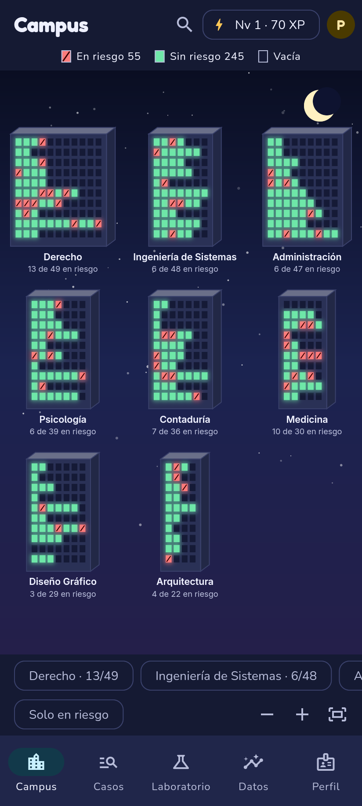
  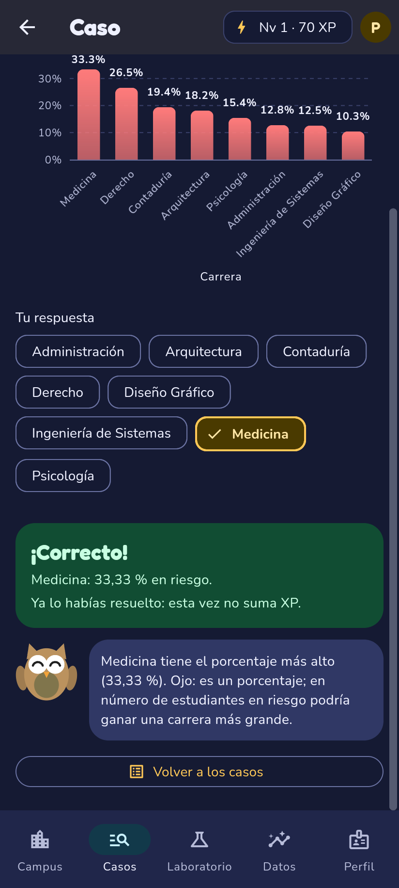
  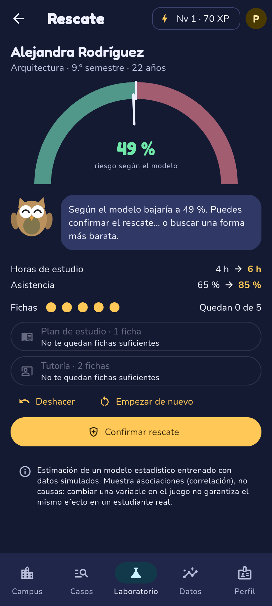
  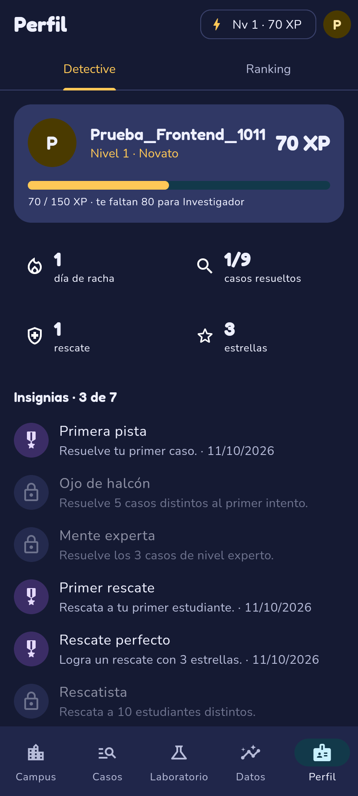
</p>
<p>
  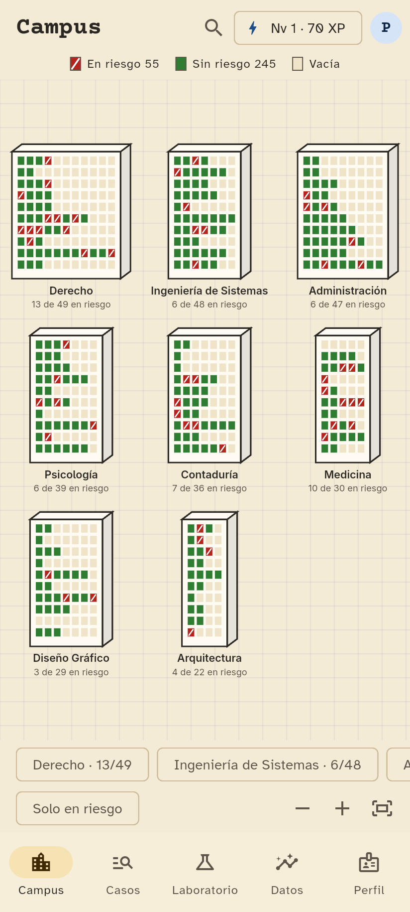
  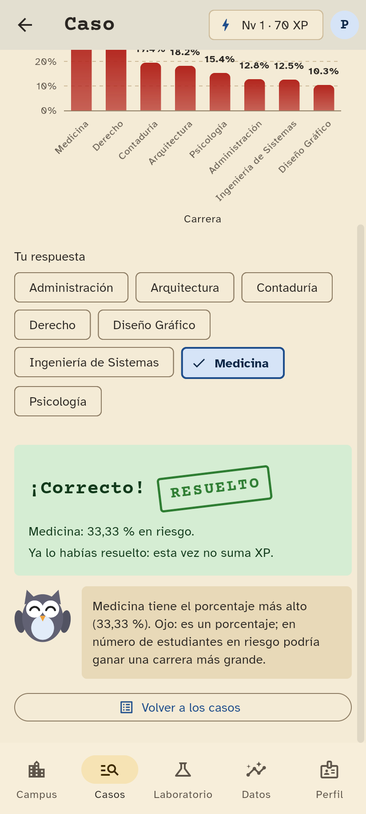
  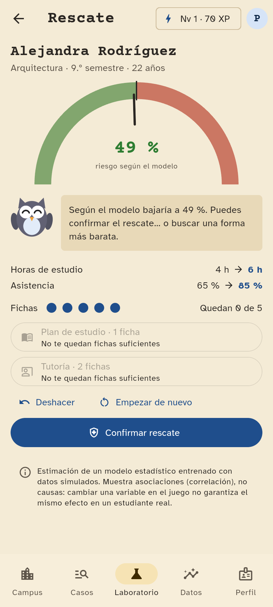
  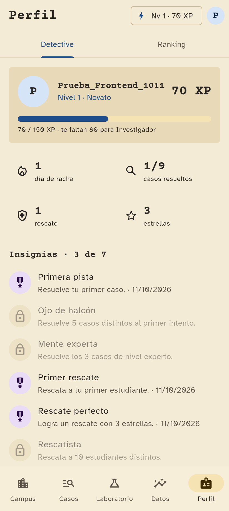
</p>

| Pestaña | Qué hace | Endpoints |
|---|---|---|
| **Campus** | Mapa 2.5D (Flame): cada edificio es una carrera, cada piso un semestre y cada ventana un estudiante, roja si está en riesgo. Tocar un edificio abre su expediente; tocar una ventana, la ficha del estudiante | `GET /estudiantes/` |
| **Casos** | Arriba, «¿Un duelo?»: el [duelo de cartas](#duelo-de-cartas) contra el Búho Máquina. Debajo, 9 preguntas en 3 niveles que se resuelven mirando los datos (con la gráfica que ayuda como «ficha del caso»). El servidor decide si es correcto y cuánta XP da; el búho da el dato real, la explicación o la pista | `/juego/casos/*`, `/duelos/*` |
| **Laboratorio** | Juego de rescate: con 5 fichas (plan de estudio, tutoría) hay que bajar de 50 % el riesgo que estima el modelo para un estudiante real. Medidor en vivo, búho guía, estrellas que decide el servidor y el «¿por qué?» con el peso de cada variable | `/laboratorio/*`, `POST /prediccion/riesgo/lote` |
| **Datos → Estudiantes** | Listado con buscador, filtro "en riesgo", indicador de color (promedio < 3,0), pull-to-refresh y pantalla de detalle | `GET /estudiantes/` |
| **Datos → Gráficas** | Gráfica de barras (fl_chart) de 6 estadísticas, con el valor encima de cada barra y un resumen | `GET /estudiantes/estadisticas/{tipo}` |
| **Datos → Predicción** | Formulario (carrera + 4 sliders) que predice el riesgo académico, con el resultado en rojo/verde y las métricas del modelo | `GET /prediccion/metricas`, `POST /prediccion/riesgo` |
| **Perfil** | Nivel, XP y avance, racha, casos, rescates, estrellas e insignias; ranking semanal e histórico. Los docentes entran desde aquí a su panel | `/juego/progreso`, `/juego/ranking` |


## Pruébala ya (versión en la nube)

| | Enlace |
|---|---|
| **App web** | <https://buelvasmanuel.github.io/app-estudiantes/> |
| **APK Android** | [Estudiantes.apk](https://github.com/buelvasmanuel/app-estudiantes/releases/latest/download/Estudiantes.apk) ([todas las versiones](https://github.com/buelvasmanuel/app-estudiantes/releases)) · Android 7.0+ |
| **API** | <https://api-tienda-wjac.onrender.com/docs> |

Hace falta una cuenta: al abrir la app, **«¿No tienes cuenta? Regístrate»**
(alias y contraseña de al menos 10 caracteres). En el APK la sesión se
recuerda; en la web, al recargar la página hay que volver a entrar (el token
no se guarda en el navegador, ver [Cuentas y sesión](#cuentas-y-sesión)).

La API está en el plan gratuito de Render, que se apaga tras ~15 min sin uso:
la primera carga puede tardar hasta un minuto (la app lo avisa con
*"Despertando el servidor…"*).

### Instalar el APK

1. Abre el enlace del APK **desde el celular** y descarga `Estudiantes.apk`.
2. Ábrelo. Si Android lo pide, permite **"Instalar apps desconocidas"** para el
   navegador (o el gestor de archivos).
3. Si Play Protect avisa de una app no reconocida: **Más detalles → Instalar de
   todas formas**. (Va firmada con la clave de depuración: sirve para instalarla
   a mano, no para publicarla en Google Play.)

Si ya tenías instalada una versión de `flutter run`, se actualiza encima (misma
firma de depuración).

> **Para ejecutar el proyecto completo (API + app) desde cero en Windows o
> Linux:** ver [INSTRUCCIONES_PROFESOR.md](INSTRUCCIONES_PROFESOR.md).

## Requisitos

- Flutter 3.47 o superior (probado con 3.47.2 / Dart 3.13).
- La API `api-tienda` con datos (`python -m scripts.seed_estudiantes`), el
  modelo entrenado (`python -m scripts.entrenar_modelo`) y las cuentas de
  usuario (`/auth`, ver `docs/CONTRATO_AUTH.md` en `api-tienda`).
- Paquetes: [`http`](https://pub.dev/packages/http),
  [`fl_chart`](https://pub.dev/packages/fl_chart),
  [`flutter_riverpod`](https://pub.dev/packages/flutter_riverpod),
  [`go_router`](https://pub.dev/packages/go_router) y
  [`flutter_secure_storage`](https://pub.dev/packages/flutter_secure_storage).
- **Linux**: `libsecret` (guarda la sesión en el llavero del sistema) y
  GStreamer con sus plugins *base* y *good* (sonidos: leer MP3 y sacarlos por
  el altavoz):
  - Arch: `sudo pacman -S libsecret gstreamer gst-plugins-base gst-plugins-good`
  - Ubuntu/Debian: `sudo apt install libsecret-1-dev libgstreamer1.0-dev
    libgstreamer-plugins-base1.0-dev gstreamer1.0-plugins-base
    gstreamer1.0-plugins-good`
- **Windows**: nada extra para el sonido (Media Foundation reproduce MP3). En
  las ediciones **N** de Windows hay que instalar el *Media Feature Pack*.
- **Android y web**: nada extra.

```bash
flutter pub get
```

## 1. Arrancar la API

En `~/Proyectos/api-tienda`, con el entorno virtual activado:

```bash
uvicorn app.main:app --reload --host 0.0.0.0
```

`--host 0.0.0.0` hace que la API escuche en **todas** las interfaces de red.
Con el valor por defecto (`127.0.0.1`) solo acepta conexiones del propio PC,
y el celular no podría llegar a ella por WiFi.

Comprueba que responde: <http://127.0.0.1:8000/docs>.

## 2. Ejecutar la app

### Linux (escritorio) — lo más rápido para desarrollar

```bash
flutter run -d linux
```

### Windows (escritorio)

Requiere Visual Studio 2022 con "Desarrollo para el escritorio con C++".

```bat
flutter run -d windows
```

### Chrome / Brave (web)

```bash
flutter run -d chrome
```

Funciona porque la API permite CORS desde cualquier origen
(`allow_origins=["*"]`, solo para desarrollo).

### Celular por USB (recomendado para probar en el celular)

Activa la *depuración USB* en el celular (Opciones de desarrollador),
conéctalo y comprueba que aparece en `flutter devices`. Después:

```bash
adb reverse tcp:8000 tcp:8000
flutter run -d <id-del-celular> --dart-define=API_URL=http://127.0.0.1:8000
```

`adb reverse` crea un túnel por el cable: el puerto 8000 **del celular**
lleva al puerto 8000 **del PC**. Así no dependes de la WiFi, de la IP del PC
ni del cortafuegos. Hay que repetirlo cada vez que se desconecta el cable.

### Celular por WiFi (misma red que el PC)

```bash
ip -4 addr            # busca la IP de la WiFi: inet 192.168.x.y/24
flutter run -d <id-del-celular> --dart-define=API_URL=http://192.168.x.y:8000
```

Si no conecta, abre el puerto en el cortafuegos
(`sudo ufw allow 8000/tcp` o `sudo firewall-cmd --add-port=8000/tcp`).

### Emulador de Android

Crea un emulador en Android Studio (*Device Manager*) y:

```bash
flutter emulators --launch <nombre>
flutter run
```

No hace falta `--dart-define`: en Android la app usa por defecto
`http://10.0.2.2:8000`, la dirección especial con la que el emulador llega al
PC anfitrión (dentro del emulador, `127.0.0.1` es el propio emulador).

## Configuración de la URL de la API

La URL se decide en `lib/config.dart`:

| Dónde corre | URL por defecto |
|---|---|
| APK de la Release y web de GitHub Pages | `https://api-tienda-wjac.onrender.com` (compilada con `--dart-define`) |
| Android (emulador) | `http://10.0.2.2:8000` |
| Windows, Linux, Chrome | `http://127.0.0.1:8000` |
| Cualquiera, con `--dart-define=API_URL=...` | la que indiques |

`String.fromEnvironment('API_URL')` se resuelve **al compilar**: si cambias
la URL hay que volver a lanzar `flutter run` (el *hot reload* no basta).

## Android: `INTERNET` y `networkSecurityConfig`

En `android/app/src/main/AndroidManifest.xml`:

```xml
<uses-permission android:name="android.permission.INTERNET"/>
<application android:networkSecurityConfig="@xml/network_security_config" ...>
```

- **`INTERNET`**: sin este permiso Android no deja que la app abra conexiones
  de red. En modo *debug* Flutter lo añade por su cuenta, pero en *release*
  (`flutter build apk`) la app no podría hablar con la API si faltara.
- **`networkSecurityConfig`**: desde Android 9 se bloquea por defecto el
  tráfico HTTP **sin cifrar** (`http://`, sin la *s*). Hay dos versiones del
  archivo y Gradle elige una según el modo de compilación:

  | Archivo | Se usa en | HTTP sin cifrar |
  |---|---|---|
  | `src/main/res/xml/network_security_config.xml` | release y profile (el APK que se publica) | **No**: solo `https://` (la API de Render) |
  | `src/debug/res/xml/network_security_config.xml` | debug (`flutter run`) | Sí: para la API local (emulador, `adb reverse` o WiFi) |

  Así ningún token de sesión viaja sin cifrar en el APK publicado. Por eso un
  APK de release **no** funciona contra `http://192.168.x.y:8000`: para
  probar con la API local usa `flutter run` (debug).

## Estructura

```
lib/
├── main.dart                  # ProviderScope + MaterialApp.router
├── router.dart                # Rutas (go_router) y barra de 5 pestañas
├── providers.dart             # Providers de Riverpod (ApiService, sesión y datos)
├── config.dart                # URL de la API (--dart-define) y timeout
├── laboratorio/               # Pestaña Laboratorio (CONTRATO_LABORATORIO.md)
│   ├── modelo.dart            # Caso, Intervencion, Explicacion, ResultadoRescate
│   ├── rescate.dart           # Reglas en local (fichas, topes, combinaciones)
│   ├── laboratorio_api.dart   # Endpoints; todas las combinaciones en 1 petición
│   ├── apariencia.dart        # Interfaz búho + medidor (hoy Flutter, mañana Rive)
│   ├── textos.dart            # Lo que dice el búho ("según el modelo…")
│   └── explicacion_vista.dart # El "¿por qué?" y el aviso del modelo
├── juego/                     # Casos, progreso, insignias, ranking (CONTRATO_JUEGO.md)
│   ├── modelo.dart            # Tipos del contrato (Recompensa, Progreso, Ranking...)
│   ├── juego_api.dart         # Endpoints y providers (se rehacen al cambiar de cuenta)
│   ├── celebracion.dart       # Subida de nivel / insignia nueva (≤ 1,2 s, saltable)
│   └── lote.dart              # Revisión de la lista de alias del docente
├── duelo/                     # Duelo de cartas (CONTRATO_DUELO.md)
│   ├── modelo.dart            # Carta, Ronda, Duelo; formato de cada atributo
│   ├── duelo_api.dart         # Endpoints; abrir (retomar o crear) y jugar con reintentos
│   └── cartas.dart            # Carta rival (se gira), carta propia y filas de atributos
├── campus/                    # Pestaña Campus
│   ├── modelo.dart            # Campus y Edificio (pisos = semestres)
│   ├── disposicion.dart       # Geometría, cámara (Vista) y qué hay bajo un toque
│   ├── controlador.dart       # Estado compartido entre la interfaz y Flame
│   └── juego.dart             # Dibujo con Flame (solo dibuja)
├── theme.dart                 # ColoresEstado: rojo/verde de riesgo de cada tema
├── tema/temas.dart            # Temas Noche y Expediente (+ fondo del campus, sello)
├── preferencias.dart          # Tema, sonidos y tutorial guardados en el dispositivo
├── sonidos.dart               # Efectos opcionales (apagados por defecto)
├── formato.dart               # Números como en Colombia: "3,80", "1.250", "33,3 %"
├── models/
│   ├── json_utils.dart        # Lectura segura de JSON (num, String, bool...)
│   ├── estudiante.dart
│   ├── estadistica.dart       # Estadistica + enum TipoEstadistica (6 tipos)
│   ├── prediccion.dart        # Entrada, resultado y métricas del modelo
│   └── sesion.dart            # Usuario, Rol y Tokens (respuesta de /auth)
├── services/
│   ├── api_service.dart       # Único punto que habla con la API (+ interceptores)
│   ├── sesion.dart            # GestorSesion: login, registro, logout, refresh
│   └── almacen_refresh.dart   # Dónde se guarda el refresh token
├── screens/
│   ├── acceso_screen.dart     # Login, registro y "recuperando sesión"
│   ├── tutorial_screen.dart   # Tutorial del búho (la primera vez)
│   ├── campus_screen.dart     # Leyenda, mapa, lista de edificios y paneles
│   ├── casos_screen.dart      # Casos por nivel
│   ├── caso_juego_screen.dart # Un caso: ficha, opciones y veredicto
│   ├── duelo_screen.dart      # El duelo: marcador, cartas, búho y resultado
│   ├── perfil_screen.dart     # Detective (nivel, insignias) y ranking
│   ├── docente_screen.dart    # Alta de cuentas en lote y lista de jugadores
│   ├── laboratorio_screen.dart # Lista de casos del Laboratorio
│   ├── rescate_screen.dart    # Jugar un caso y ver el resultado
│   ├── estudiantes_screen.dart
│   ├── estudiante_detalle_screen.dart
│   ├── graficas_screen.dart
│   └── prediccion_screen.dart
└── widgets/
    ├── estado_vistas.dart     # Cargando / Error con Reintentar / Vacío
    ├── grafica_barras.dart    # BarChart de fl_chart
    ├── menu_cuenta.dart       # Alias + cerrar sesión (barra superior)
    └── promedio_badge.dart    # Pastilla y avatar con el color del riesgo
```

## Publicar una versión nueva

**Web (GitHub Pages):** se publica sola en cada push a `main` con el workflow
`.github/workflows/web.yml`, que compila con la variable del repositorio
`API_URL`:

```bash
gh variable set API_URL --body "https://api-tienda-wjac.onrender.com"   # una sola vez
git push                                                               # compila y publica
```

**APK:** se compila en local con la URL de la API y se sube como Release:

```bash
flutter build apk --release --dart-define=API_URL=https://api-tienda-wjac.onrender.com
cp build/app/outputs/flutter-apk/app-release.apk Estudiantes.apk
gh release create v1.1.0 Estudiantes.apk --title "Estudiantes 1.1.0" --notes "..."
```

(Sube también `version:` en `pubspec.yaml`, p. ej. `1.1.0+2`, para que Android
la reconozca como actualización.)

## Tests

```bash
flutter analyze                 # análisis estático: 0 issues
flutter test                    # tests de modelos y de widgets (API simulada)
```

Los tests de widgets usan `MockClient` (de `package:http/testing.dart`) para
simular la API: no necesitan red ni la API encendida.

Con la API corriendo, la prueba de extremo a extremo abre la app de verdad y
comprueba que las 3 pestañas cargan datos reales (y las 6 gráficas):

```bash
flutter test integration_test/app_real_test.dart -d linux \
  --dart-define=API_URL=https://api-tienda-wjac.onrender.com \
  --dart-define=ALIAS=… --dart-define=PASSWORD=…
```

(Las pruebas contra la API real inician sesión con esa cuenta de prueba.)

Registro, refresh, logout y login contra la API real (crea la cuenta que se
indique):

```bash
flutter test integration_test/auth_real_test.dart -d linux \
  --dart-define=API_URL=https://api-tienda-wjac.onrender.com \
  --dart-define=ALIAS=Prueba_Frontend_1 --dart-define=PASSWORD='una contraseña larga'
```

Los sonidos reales de la plataforma (en Linux, GStreamer; si faltan plugins
dice cuáles y cómo instalarlos, y se salta si el equipo no tiene salida de
audio):

```bash
flutter test integration_test/sonidos_test.dart -d linux
```

El almacén seguro real de la plataforma (en Linux, libsecret) se prueba con:

```bash
flutter test integration_test/almacen_seguro_test.dart -d linux
```

Para regenerar las capturas de `docs/capturas/<tema>/` (412×915, datos reales;
recorre acceso, tutorial, campus, casos, laboratorio, datos y perfil):

```bash
for tema in noche expediente; do
  flutter test integration_test/capturas_test.dart -d linux \
    --dart-define=TEMA=$tema --dart-define=API_URL=http://127.0.0.1:8001 \
    --dart-define=ALIAS=… --dart-define=PASSWORD=… \
    --dart-define=CAPTURAS_DIR=$PWD/docs/capturas
done
```

## Problemas típicos

| Síntoma | Causa y solución |
|---|---|
| En Linux los sonidos no suenan (en la consola: `LinuxAudioError … gst-stream-error-quark`) | Faltan plugins de GStreamer para leer MP3: Arch `sudo pacman -S gst-plugins-base gst-plugins-good`, Ubuntu `sudo apt install gstreamer1.0-plugins-base gstreamer1.0-plugins-good`. `flutter test integration_test/sonidos_test.dart -d linux` dice exactamente qué falta. La app sigue funcionando sin sonido. |
| "Sin conexión con la API" | La API no está corriendo, o no escucha en `0.0.0.0`, o la URL no es la correcta para ese dispositivo (ver tabla de arriba). |
| Funciona en Linux pero no en el celular | Falta `adb reverse tcp:8000 tcp:8000` (USB) o la IP/cortafuegos (WiFi). |
| "Servicio no disponible (503): Modelo no entrenado" | En la API: `python -m scripts.entrenar_modelo`. |
| Lista vacía | En la API: `python -m scripts.seed_estudiantes`. |
| El celular aparece y desaparece en `flutter devices` | Hay dos `adb` instalados (`/usr/bin/adb` y el del SDK). Deja solo uno. |
| Cambié `API_URL` y no hace nada | Es de compilación: detén la app y vuelve a hacer `flutter run`. |

## Cuentas y sesión

La app pide iniciar sesión (o registrarse con alias y contraseña) antes de
mostrar nada. Implementa el contrato `docs/CONTRATO_AUTH.md` del repo
`api-tienda`:

| | |
|---|---|
| **Access token** | Va en `Authorization: Bearer …`; dura 15 min y se guarda solo en memoria. Si le queda menos de 1 min, se renueva antes de enviar. |
| **Refresh token** | Android, Windows y Linux: en el almacén seguro del sistema (`flutter_secure_storage`), así la sesión sobrevive a cerrar la app. **Web: solo en memoria** (recargar la página = volver a entrar): en el navegador no hay un almacén realmente seguro. |
| **Interceptor** (`GestorSesion`) | Ante un `401` de token caducado renueva y repite la petición **una vez**. Si varias peticiones necesitan renovar a la vez, hay **un solo refresh en curso** y las demás lo esperan: con tokens rotativos, dos renovaciones con el mismo token parecerían un robo y la API cerraría la sesión. |
| **Sin respuesta al renovar** | Se reintenta con el **mismo** refresh: una vez tras un timeout y hasta 2 tras un error de red, nunca pasados 110 s (la API lo acepta repetido durante 120 s). Si se agotan, error de conexión y se conservan los tokens. |
| **Sesión cerrada** | Si la API rechaza el refresh (sesión revocada, caducada o cuenta desactivada) se borran los tokens y se vuelve al login con un aviso. Sin red, los tokens se conservan. |
| **Android** | `allowBackup="false"`: el refresh token no viaja en la copia de seguridad de Google. |

## Campus

<p>
  
  
</p>

- **Lectura:** edificio = carrera (ordenados de más a menos estudiantes), piso
  = semestre (1.º abajo), ventana = estudiante en su orden real. Rojo con
  franja diagonal = en riesgo (promedio < 3.0; la franja sirve sin distinguir
  colores), verde = sin riesgo, apagada = hueco. Todos los edificios tienen 10
  pisos para que se comparen de un vistazo; el ancho es el piso más lleno.
- **Datos:** solo `GET /estudiantes/` (el mismo provider que la lista); las
  cifras se calculan en el cliente.
- **Flame solo dibuja.** Los gestos (arrastrar, pellizcar, rueda, toque) los
  recoge Flutter y cambian `ControladorCampus`; el juego copia la cámara en
  cada fotograma. Así la geometría y "qué hay bajo el dedo" son funciones
  puras con tests.
- **Reglas anti-caos:** una sola animación protagonista (las ventanas se
  encienden piso a piso en 1,2 s; un toque la salta); el filtro "Solo en
  riesgo" es un fundido de 200 ms; los paneles, 250 ms; los textos no se
  mueven. Con **"reducir movimiento"** del sistema todo aparece al instante.
- **Sin saltos:** la rejilla solo cambia si cambia el ancho (girar el
  celular); al abrir el panel, el edificio elegido sigue encuadrado.
- **Accesibilidad:** el lienzo no lo leen los lectores de pantalla; la lista
  de edificios bajo el mapa sí (con sus cifras) y sirve para navegar con
  teclado. Con poco zoom, tocar elige el edificio; las ventanas solo se pueden
  tocar cuando miden ≥ 12 px.
- **En otra pestaña el juego se pausa** (no gasta batería dibujando).

Captura con datos reales (necesita la API):

```bash
flutter test integration_test/campus_test.dart -d linux \
  --dart-define=API_URL=https://api-tienda-wjac.onrender.com \
  --dart-define=CAPTURAS_DIR=$PWD/docs/capturas
```

## Laboratorio de rescate

<p>
  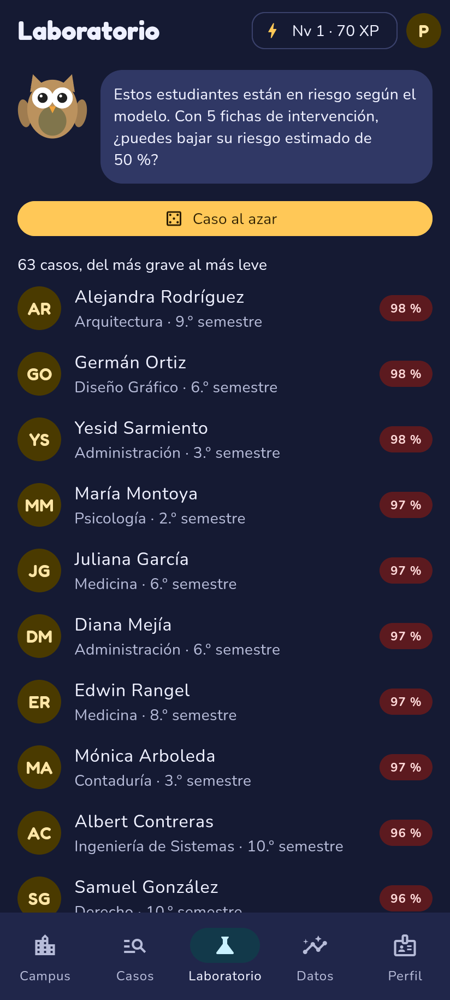
  
  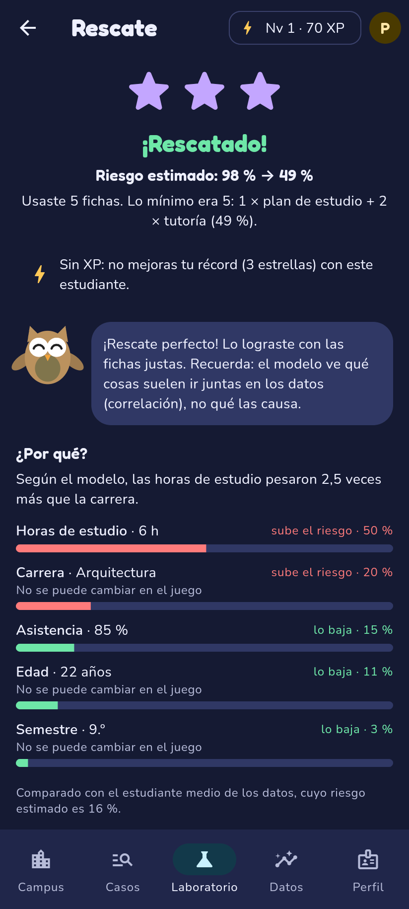
</p>
<p>
  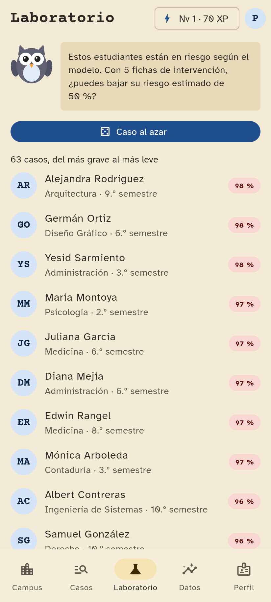
  
  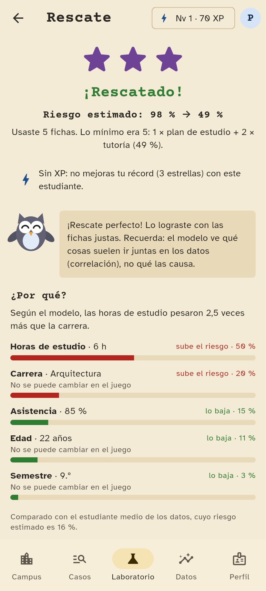
</p>

Implementa `docs/CONTRATO_LABORATORIO.md` (repo `api-tienda`):

- **Reglas en el servidor.** Costes, efectos y topes de las intervenciones
  llegan en el catálogo del caso; las **estrellas y la solución óptima las
  calcula siempre la API** (`…/resolver`). La app solo aplica las fichas en
  local para mover el medidor.
- **Medidor sin esperas:** al abrir un caso se piden las probabilidades de
  **todas** las combinaciones posibles (12 con 5 fichas) en una sola petición
  a `/prediccion/riesgo/lote`; después cada ficha mueve la aguja al instante.
- **Estimación, no causa.** El búho habla siempre de lo que estima el modelo
  («según el modelo…») y al final recuerda que es correlación, no
  causalidad; el `aviso` de la API está siempre visible. La explicación marca
  qué variables «no se pueden cambiar en el juego» (edad, semestre, carrera).
- **Búho y medidor intercambiables:** las pantallas usan
  `AparienciaLaboratorio`; hoy se dibujan con Flutter y en la Fase 7 se podrá
  cambiar a Rive con otro provider, sin tocar las pantallas.
- **Anti-caos:** la aguja (400 ms) es la animación protagonista del juego y
  las estrellas (< 1 s, se saltan con un toque) la del resultado; el búho
  cambia de cara con un fundido de 150 ms; los números y textos no se animan.
  Con "reducir movimiento", nada se mueve.

Prueba de punta a punta (con una API que ya tenga `/laboratorio`, p. ej. la
local en el puerto 8001):

```bash
flutter test integration_test/laboratorio_real_test.dart -d linux \
  --dart-define=API_URL=http://127.0.0.1:8001 \
  --dart-define=ALIAS=Prueba_Frontend_1 --dart-define=PASSWORD='una contraseña larga' \
  --dart-define=CAPTURAS_DIR=$PWD/docs/capturas
```

## Casos, progresión y panel del docente

<p>
  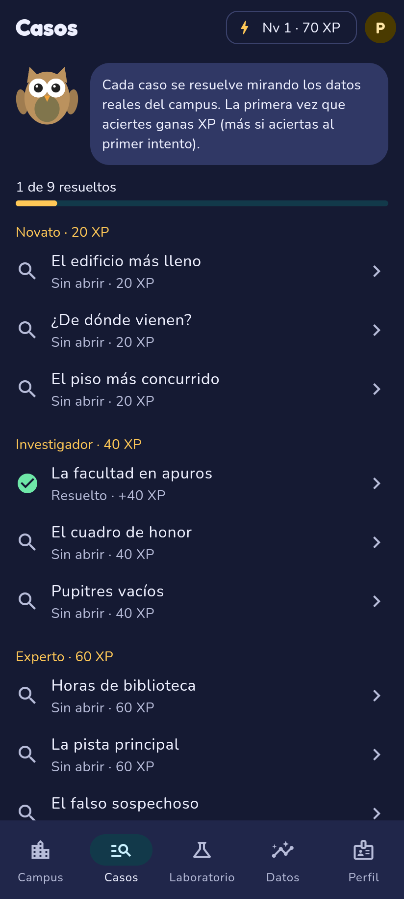
  
  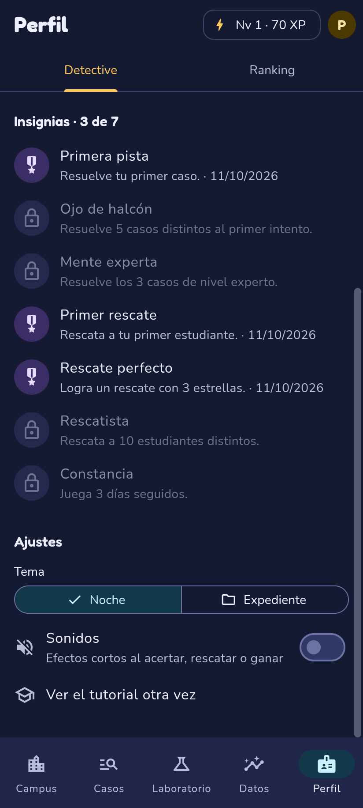
  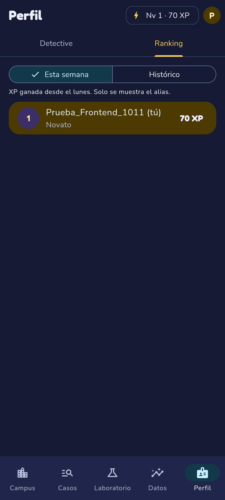
</p>
<p>
  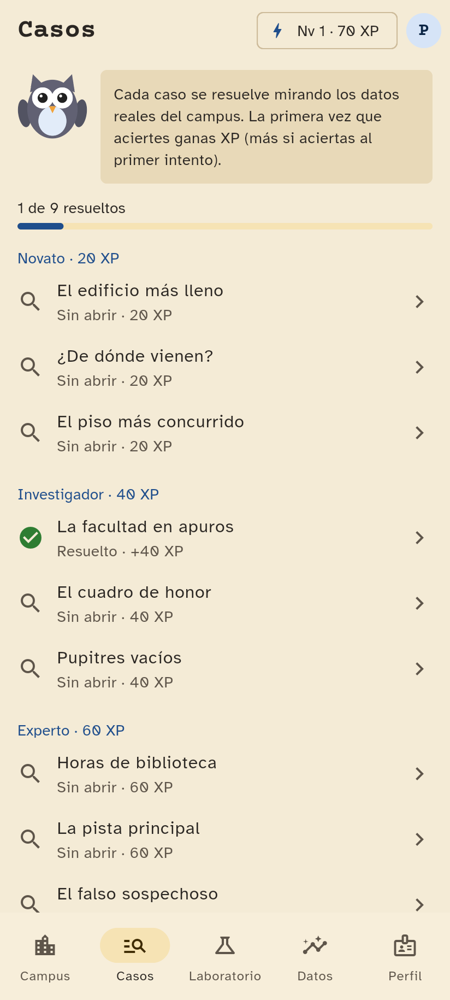
  
  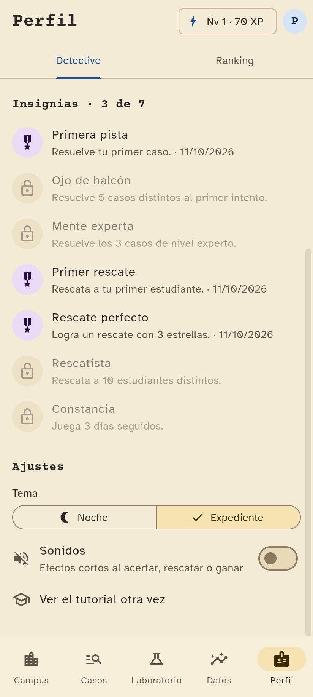
  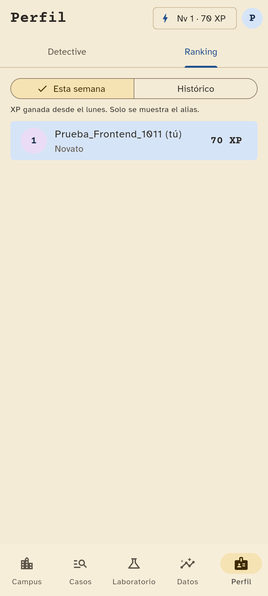
</p>

Implementa `docs/CONTRATO_JUEGO.md` v1 y `CONTRATO_LABORATORIO.md` v1.1:

- **Todo lo decide el servidor:** si una respuesta es correcta, la XP, el
  nivel, las insignias y el ranking. La app solo muestra lo que devuelve.
- **XP y nivel siempre a la vista:** un chip «Nv 2 · 230 XP» en la barra
  superior de cada pantalla (lleva al perfil). Tras cada respuesta o rescate
  se recargan el progreso, el ranking y la lista de casos.
- **Celebración** (subir de nivel o insignia nueva): es la animación
  protagonista de ese momento (≤ 1,2 s, un toque la salta, quieta con
  "reducir movimiento"). Si llega al terminar un rescate, las estrellas
  aparecen quietas para no competir con ella.
- **Rescates:** al terminar muestran la XP ganada (10 por cada estrella que
  mejora tu récord con ese estudiante) y las insignias nuevas. Con un
  servidor anterior a la v1.1 (sin esos campos) la pantalla sigue igual.
- **Panel del docente** (roles docente y admin; también en el menú de la
  cuenta): pegar una lista de alias (uno por línea o separados por comas) y
  crear hasta 40 cuentas de jugador a la vez. Las contraseñas generadas solo
  se ven en ese momento: hay un botón «Copiar todas» (para pegar en una hoja
  de cálculo) y la app avisa antes de salir sin copiarlas. La pestaña
  «Jugadores» muestra el progreso de cada uno.
- Sin sesión no se pide nada de `/juego` (la API respondería 401), y al
  cambiar de cuenta todo lo del jugador se vuelve a pedir.

Prueba de punta a punta (API con `/juego`, un jugador y un docente; crea 2
cuentas de alumno con alias nuevos):

```bash
flutter test integration_test/juego_real_test.dart -d linux \
  --dart-define=API_URL=http://127.0.0.1:8001 \
  --dart-define=ALIAS=… --dart-define=PASSWORD=… \
  --dart-define=ALIAS_DOCENTE=… --dart-define=PASSWORD_DOCENTE=… \
  --dart-define=CAPTURAS_DIR=$PWD/docs/capturas
```

## Duelo de cartas

<p>
  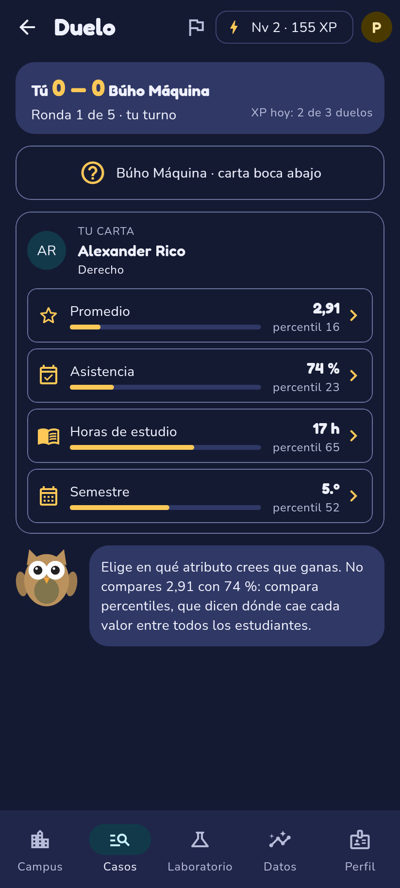
  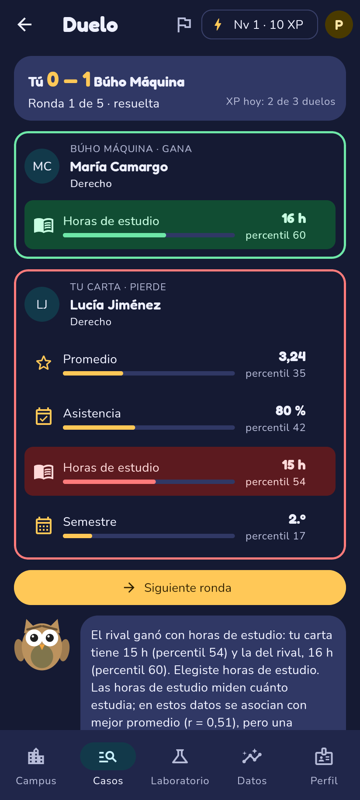
  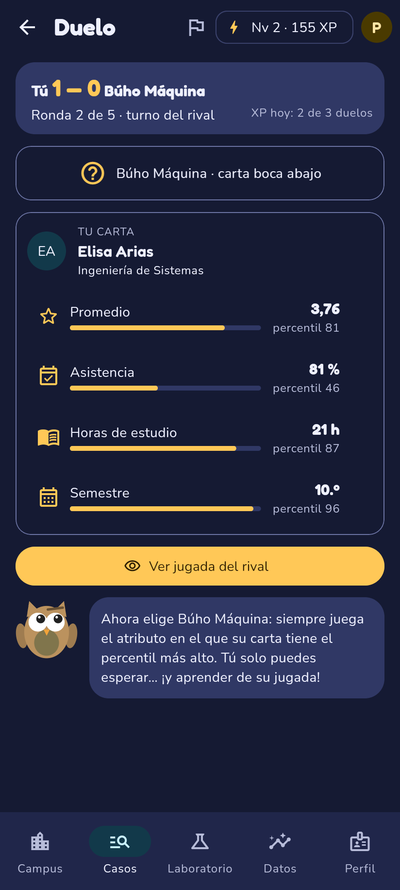
  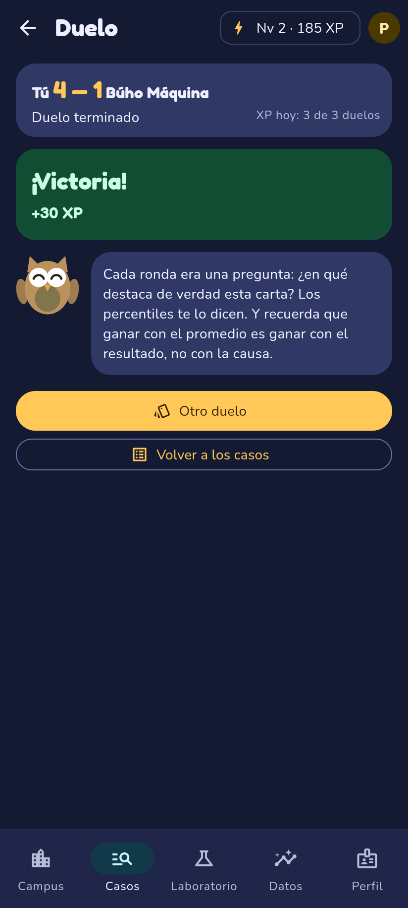
</p>
<p>
  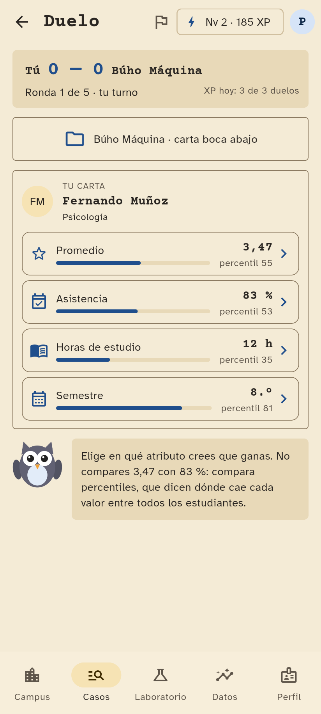
  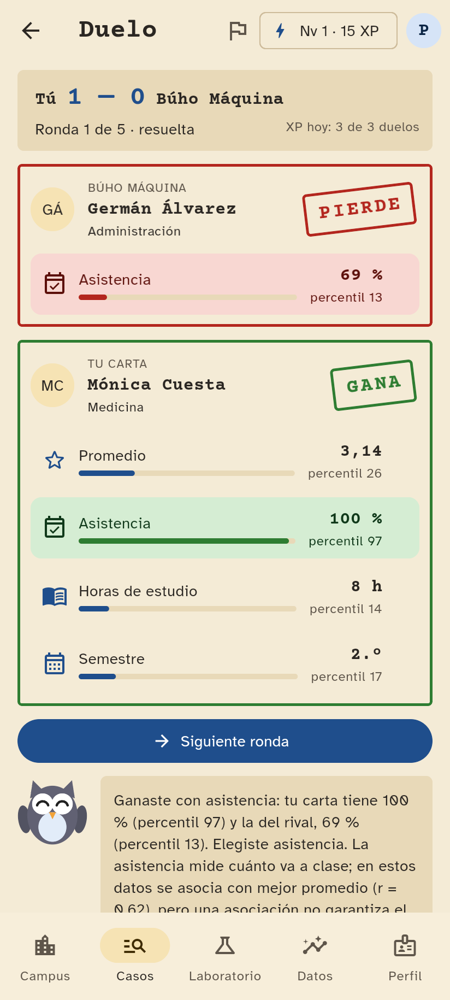
  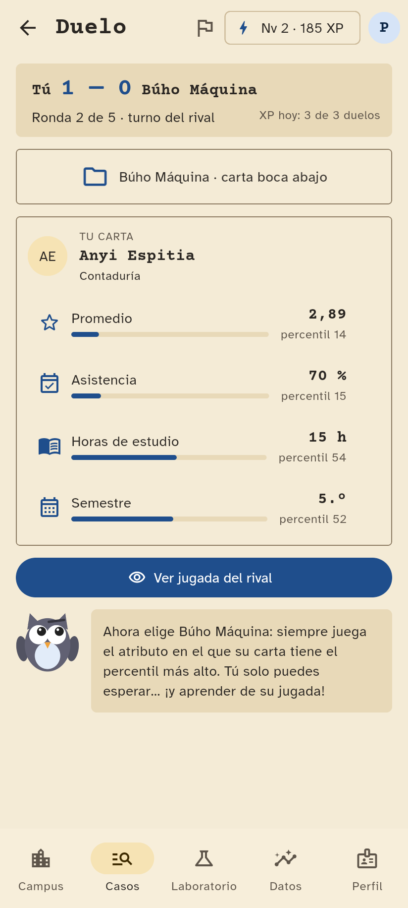
  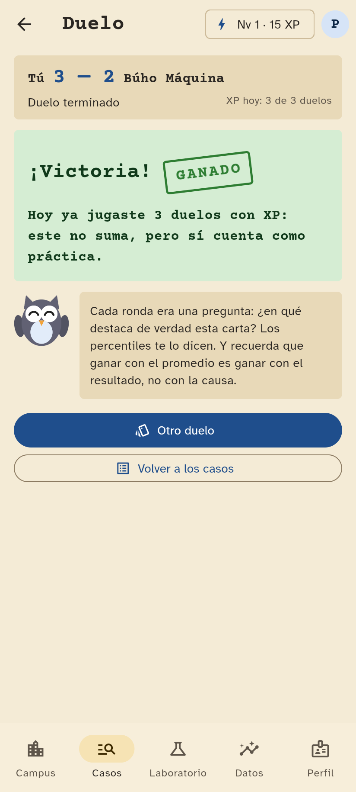
</p>

Implementa `docs/CONTRATO_DUELO.md` v1 (contra la máquina). Se entra desde la
tarjeta «¿Un duelo?», arriba en **Casos**, o desde el **Perfil**.

- **Cartas = estudiantes reales**, con promedio, asistencia, horas de estudio
  y semestre, cada uno con su **percentil** (la barra). 5 rondas; quien tiene
  el turno elige el atributo viendo solo su carta y gana el valor más alto.
  En el turno de la máquina, «Ver jugada del rival».
- **Todo lo decide el servidor:** reparto, turno, ganador de cada ronda,
  resultado y XP (30/15/5, solo los 3 primeros duelos del día). La cabecera
  dice cuántos llevas hoy.
- **Animación protagonista:** al resolverse la ronda, la carta del rival se
  **gira** (350 ms, un toque la termina; con "reducir movimiento" aparece ya
  girada). Lo demás no se mueve. En Expediente, sellos GANA / PIERDE; en
  Noche, la cabecera de la carta lo dice con palabras.
- **El búho lee la `explicacion` de la API tal cual** (qué significa ganar con
  ese atributo, con los percentiles y la correlación real).
- **Retomar y reintentar:** al abrir se retoma el duelo a medias (si no hay,
  empieza uno). Si una jugada no llega (red o 5xx), se repite la misma (el
  servidor no la juega dos veces); si sigue fallando, se pide el estado del
  duelo y aparece «Reintentar». Ante un 409 (ronda o turno que ya no tocan),
  se pide el estado y se sigue desde ahí.
- **Abandonar** (bandera arriba) pide confirmación: cuenta como derrota, sin XP.
- **Preparado para la v2** (jugador contra jugador), sin funcionalidad aún:
  la cabecera ya enseña el alias del rival, un hueco para la cuenta atrás del
  turno y el aviso de rival desconectado; y el turno del otro jugador es un
  estado de espera «Esperando a…» con indicador de progreso, que no parece un
  botón ni se puede pulsar.

Un duelo entero contra la API real (retoma o empieza uno y juega siempre el
atributo con el percentil más alto); con `CAPTURAS_DIR` guarda las capturas
16-21:

```bash
flutter test integration_test/duelo_real_test.dart -d linux \
  --dart-define=TEMA=noche --dart-define=API_URL=https://api-tienda-wjac.onrender.com \
  --dart-define=ALIAS=… --dart-define=PASSWORD=… \
  --dart-define=CAPTURAS_DIR=$PWD/docs/capturas
```

## Temas: Noche y Expediente

<p>
  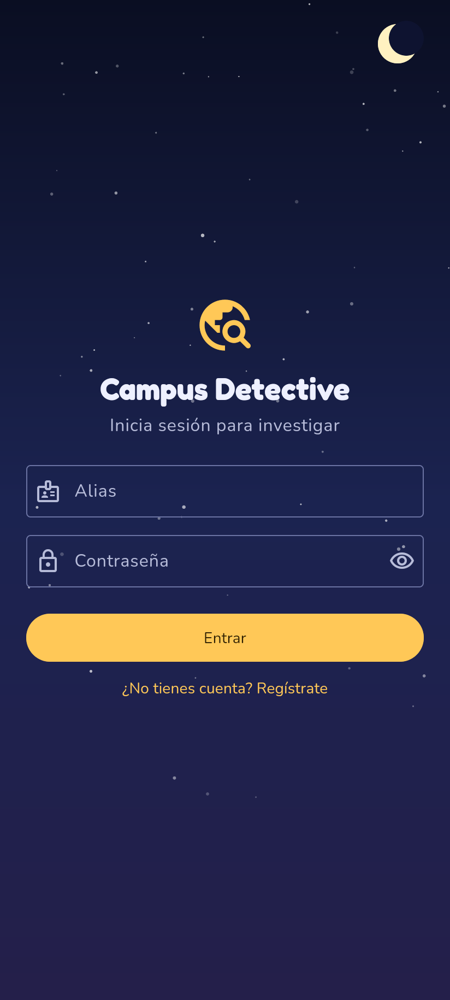
  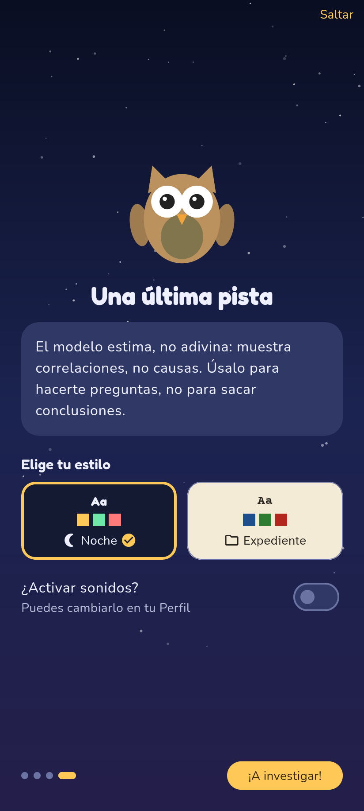
  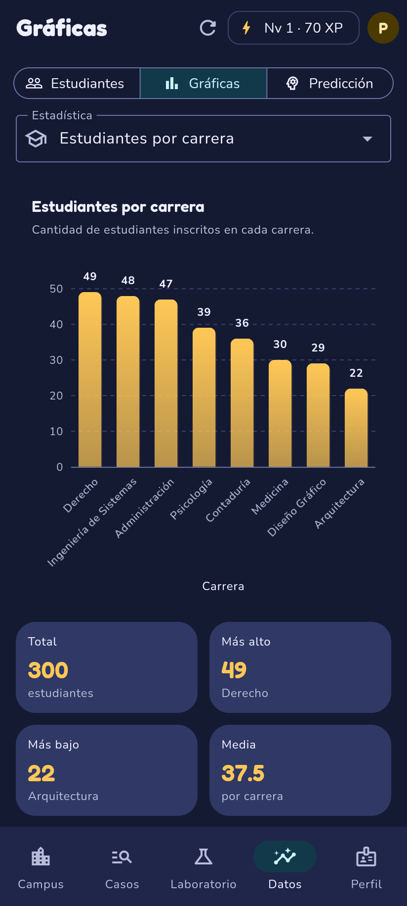
  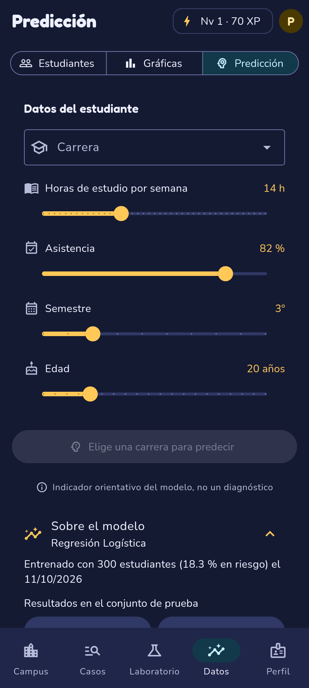
</p>
<p>
  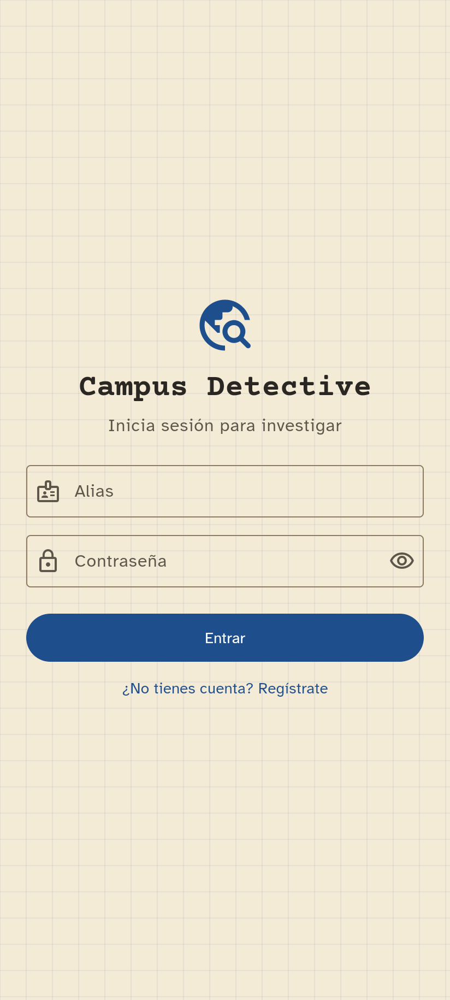
  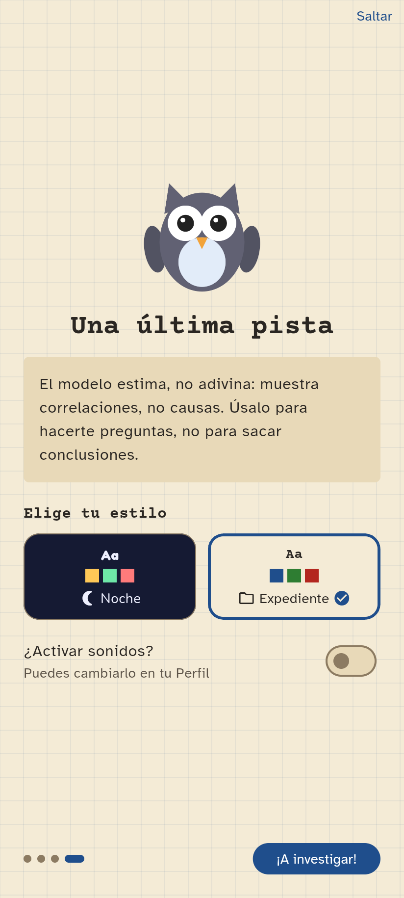
  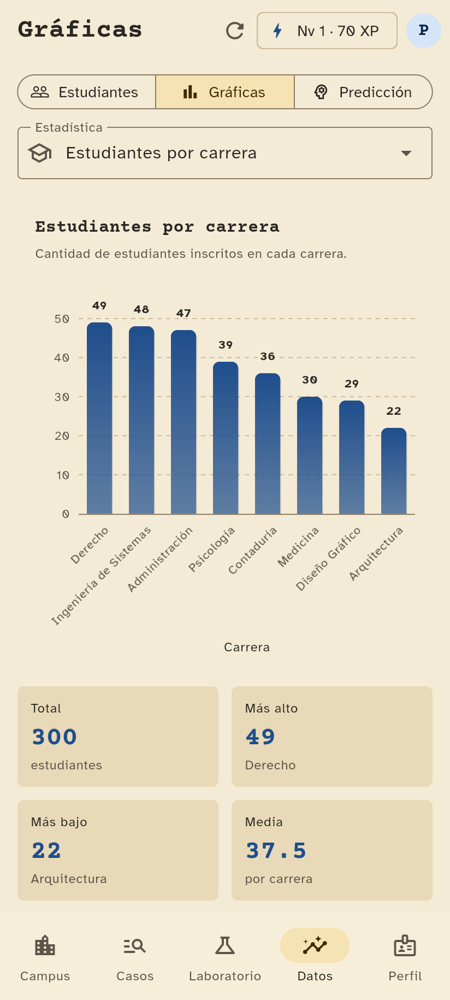
  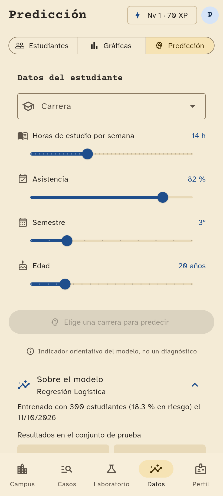
</p>

| | **Noche** | **Expediente** |
|---|---|---|
| Idea | Campus nocturno con ventanas encendidas | Carpeta de casos de detective: papel, tinta y sellos |
| Letra | **Fredoka** (títulos) + **Nunito** (texto) | **Courier Prime** (títulos) + **Atkinson Hyperlegible** (texto, pensada para baja visión) |
| Fondo | Cielo con estrellas fijas y luna; ventanas con halo | Cuadrícula de plano; edificios con contorno de tinta; sello «RESUELTO» |

- **Cómo se elige:** en el menú de la cuenta (🌙 / 📁), en el Perfil
  (*Ajustes → Tema*) o al final del tutorial. La primera vez sigue al sistema
  (oscuro → Noche, claro → Expediente). Se recuerda en el dispositivo
  (`shared_preferences`; en la web, `localStorage`).
- **El cambio** es un fundido de 250 ms, instantáneo con "reducir movimiento".
- **Lo que no cambia:** rojo con raya diagonal = en riesgo, verde = sin riesgo,
  en los dos temas.
- **Contraste:** `test/temas_test.dart` comprueba en los dos temas los pares
  de colores clave con la fórmula WCAG (≥ 4,5 el texto, ≥ 3 los elementos
  gráficos: ventanas, bordes, la leyenda, el sello).
- **Fuentes** incluidas en la app (`assets/fuentes/`, licencia SIL OFL 1.1 con
  su `OFL.txt`): funciona sin conexión y no depende de Google en tiempo de
  ejecución.

### Tutorial del búho

La primera vez que se entra en un dispositivo: 4 pasos (¡hola!, el campus, casos
y rescates, «el modelo estima, no adivina»), y en el último se elige el tema y
si se activan los sonidos. «Saltar» siempre visible. Se puede volver a ver desde
el Perfil.

### Sonidos

Cinco efectos cortos (acierto, pista, poner una ficha, rescate logrado y
celebración; 0,01-0,5 s), **apagados por defecto** en web y móvil: se activan en
el Perfil o al final del tutorial. Son de [Kenney](https://kenney.nl) con
licencia **CC0** (comprobada en el `License.txt` de cada pack; ver
`assets/sonidos/LICENCIA.txt`).

## Detalles técnicos que vale la pena conocer

- **Números como en Colombia:** coma decimal y punto de miles ("3,80",
  "1.250", "33,3 %", con espacio no separable antes del %). Todo pasa por
  `lib/formato.dart` (`formatoDecimal`, `formatoPromedio`, `formatoPorcentaje`,
  `formatoProbabilidad`, `formatoEntero`): ninguna pantalla usa
  `toStringAsFixed` para mostrar un número. Lo que llega de la API en texto
  (la explicación del duelo, el dato de un caso) se muestra tal cual.

- **El promedio llega como texto** (`"promedio": "3.95"`): en Python es un
  `Decimal` y Pydantic lo envía como string para no perder precisión. Por eso
  los modelos leen los números con `leerNum`, que acepta `int`, `double` o
  `String`. `valor` y `probabilidad` se guardan como `num` (pueden ser `30` o
  `33.33`).
- **UTF-8**: FastAPI no indica el *charset*, así que se decodifica
  `response.bodyBytes` como UTF-8 a mano (si no, "Ingeniería" saldría mal).
- **Errores**: `ApiService` convierte los fallos en un `ApiException` con un
  mensaje para el usuario: sin conexión, *timeout* (8 s), y los `detail` de
  FastAPI (texto, objeto propio o lista de validación de Pydantic).
- **Interceptores**: toda petición pasa por `ApiService.enviar(PeticionApi)`.
  Un `InterceptorApi` puede añadir cabeceras antes de enviar (p. ej.
  `Authorization`) y pedir que se repita la petición **una sola vez** tras un
  error (p. ej. un 401 por token caducado, después de renovarlo).
- **Riverpod** guarda los datos de la API (`providers.dart`): cada pantalla
  hace `ref.watch(...)` y pinta cargando / error / datos. Los datos se
  conservan hasta que el usuario pide actualizar; si la actualización falla, se
  sigue viendo lo anterior y se avisa con un *SnackBar*. Los reintentos
  automáticos de Riverpod están desactivados (`sinReintentos`): el usuario
  decide con "Reintentar".
- **go_router** con `StatefulShellRoute.indexedStack`: cada pestaña conserva
  su estado (búsqueda, formulario) al cambiar, pero **solo se construye la
  primera vez que se abre**, así que al arrancar se pide únicamente lo de la
  pestaña visible. Las rutas son URLs (`/estudiantes`, `/estudiantes/12`,
  `/graficas`, `/prediccion`); en la web van tras `#` porque GitHub Pages no
  reescribe rutas.
- **`if (!mounted) return;`** después de cada `await` antes de usar el
  `context`: la pantalla pudo cerrarse mientras llegaba la respuesta.
- **Gráficas legibles**: las etiquetas se miden con `TextPainter` y se ponen
  horizontales, inclinadas 45° o con scroll según el espacio disponible.
- **Las probabilidades del modelo** salen "infladas" hacia el riesgo
  (`class_weight="balanced"`): sirven para ordenar estudiantes, no como un
  porcentaje literal. Es un indicador orientativo, no un diagnóstico.

## Icono

Generado a partir de `assets/icono/icono.png` con:

```bash
dart run flutter_launcher_icons
```
